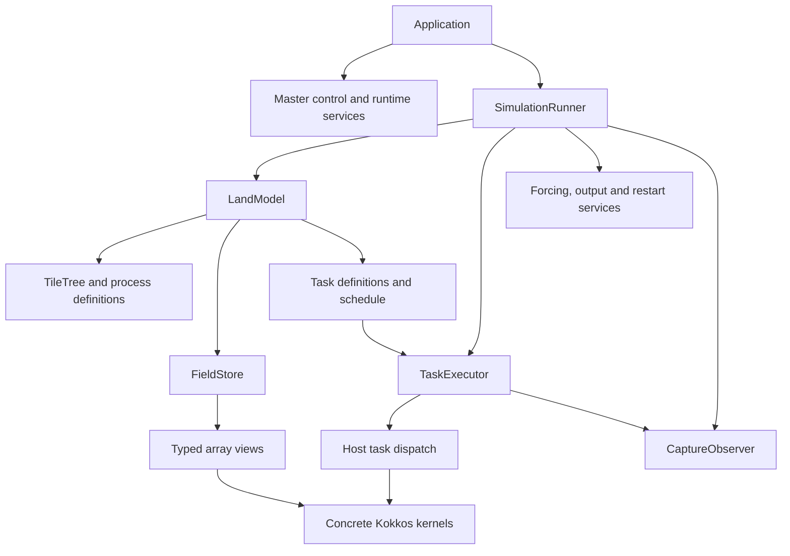

<!-- SPDX-License-Identifier: BSD-3-Clause -->

# ICON-Land C++/Kokkos design and migration test plan

Date: 14 October 2026  
Status: Design proposal; implementation has not started.  
Scope: The reduced standalone `jsbach_lite` model in this repository.

This document records the approach agreed in this conversation: create a fresh C++ application skeleton in the existing repository, move functionality into it in small tested increments, and retain the Fortran application as the reference. Add an optional capture mode to the Fortran application so both implementations can be compared at equivalent execution boundaries. Extend the same harness from startup configuration through model infrastructure to scientific kernels.

The document was prepared from source inspection. No application build, simulation, Fortran instrumentation, or C++ port was performed. Class names, directory layouts, command-line controls, schemas, and interface sketches below are proposed.

## 1. Outcome and scope

The final deliverable is an independent C++/Kokkos executable that reproduces the retained standalone model's configuration, initialisation, forcing, time stepping, scientific tasks, communication, output, and restart behavior.

Completion requires:

- All retained land-model functionality and required application services have C++ implementations or suitable C/C++ library implementations.
- The production application configures and builds without a Fortran compiler, and contains no Fortran objects or Fortran runtime dependency. The separate Fortran reference test environment may continue to require Fortran.
- The existing three-hour R2B4 experiment and its applicable consistency variants pass against a freshly generated reference.
- Representative longer and boundary-condition cases pass the agreed numerical and physical checks.
- Threaded CPU, MPI, and the selected GPU backend pass the required validation matrix.
- Inputs, dependency versions, build settings, execution instructions, and test reports are reproducible.

Ordinary C/C++ library dependencies are allowed. The scope does not restore removed atmosphere, ocean, carbon, QUINCY, river-routing, or other full ICON-Land functionality. Multi-component coupling outside the reduced model is not part of the initial target.

## 2. Source baseline and existing design

The inspected public checkout is at commit `6a4d5fec6820dc8054d81b4e7e97f37440c19044`. Its application source was copied from the upstream reduced repository at `133173041863d2879900563b7a19476ec75d5b1c`. These identify the inspected code; they do not identify a newly executed numerical reference.

The land framework already uses object-oriented Fortran:

- [`t_jsb_model`](https://github.com/ksivalingam-nv/icon-land-cpp-port/blob/6a4d5fec6820dc8054d81b4e7e97f37440c19044/externals/jsbach/src/base/mo_jsb_model_class.f90#L46) contains model state and type-bound operations.
- [`t_jsb_process_task`](https://github.com/ksivalingam-nv/icon-land-cpp-port/blob/6a4d5fec6820dc8054d81b4e7e97f37440c19044/externals/jsbach/src/base/mo_jsb_task_class.f90#L70) is abstract, with deferred `Integrate` and `Aggregate` procedures.
- [`t_jsb_tile_abstract`](https://github.com/ksivalingam-nv/icon-land-cpp-port/blob/6a4d5fec6820dc8054d81b4e7e97f37440c19044/externals/jsbach/src/base/mo_jsb_tile_class.f90#L82) represents tile behavior and extends the tile-tree node type.
- [`t_jsb_memory`](https://github.com/ksivalingam-nv/icon-land-cpp-port/blob/6a4d5fec6820dc8054d81b4e7e97f37440c19044/externals/jsbach/src/base/mo_jsb_memory_class.f90#L50) provides process memory abstractions.

The host startup code also uses procedural modules and shared configuration variables. The C++ design should retain useful domain concepts while making ownership, state changes, and dependencies explicit. It should not require one C++ class for every Fortran module.

Source analysis shows 22 queued task entries, including a repeated `snow_and_wet_fraction` entry. The number of scheduled tasks or steps depends on enabled processes and tile actions. Preserve queue occurrences and ordering; do not deduplicate them.

## 3. Design principles

1. **Port behavior through explicit contracts.** Record inputs, outputs, state changes, defaults, errors, and execution order before replacing a responsibility.
2. **Prefer composition.** A model contains a tile tree, fields, process definitions, and a schedule. Introduce inheritance only where substitutable behavior is needed.
3. **Give state a clear owner.** Separate configuration, evolving physical state, derived caches, scratch storage, and runtime resources.
4. **Keep dependencies visible.** Pass configuration, contexts, field views, and services through interfaces rather than recreating module globals or a universal singleton.
5. **Keep numerical calculations explicit.** Pure formulas can remain ordinary functions. Host task objects obtain data and launch concrete Kokkos kernels.
6. **Validate correctness before optimisation.** Establish a fixed CPU reference before changing layout, arithmetic, reduction order, concurrency, or GPU execution.
7. **Keep the reference useful.** Fortran instrumentation must observe computation without changing equations, task ordering, timestep length, or model inputs.
8. **Grow one executable skeleton.** Add one validated functionality slice at a time; distinguish working functionality from declarations, fixtures, and temporary adapters.

This follows the [C++ Core Guidelines](https://isocpp.github.io/CppCoreGuidelines/CppCoreGuidelines#c4-make-a-function-a-member-only-if-it-needs-direct-access-to-the-representation-of-a-class): related data belongs in types, while a function need not be a member merely because the application uses objects.

## 4. Target object model

| Component | Responsibility and ownership | Main collaborators |
| --- | --- | --- |
| `Application` | Coordinate startup, execution, capture, and shutdown; own application-level resources | Runtime guards, master control, model, simulation runner |
| `MpiRuntime` | Manage MPI initialisation/finalisation and expose rank/thread-support information | Communicator wrappers, master controller |
| `KokkosRuntime` | Manage Kokkos lifetime and backend configuration | Field allocations and kernel execution |
| `MasterConfig` | Hold host-component definitions, restart policy, paths, and master time settings | Namelist reader and master controller |
| `MasterContext` | Describe this rank's selected component and relevant communicators | Model initialisation and application services |
| `MasterController` | Validate configuration and establish component assignment | `MasterConfig`, `MpiRuntime` |
| `LandModel` | Own land configuration, tile/process descriptions, persistent state, and task definitions | Grid, field store, schedule builder |
| `TileTree` | Store tile identifiers, parent/child relationships, fractions, and process actions | Schedule builder and aggregation |
| `FieldStore` | Own persistent allocations and variable metadata; expose typed access | Tasks, forcing, output, restart |
| `ProcessDefinition` | Group process identity, configuration, and task registrations | Model and task registry |
| `ScheduleBuilder` | Derive ordered task/tile/action steps from the queue and tile tree | Process actions and task definitions |
| `TaskExecutor` | Execute the schedule for a grid chunk | Tasks, field access, step context, capture observer |
| `SimulationRunner` | Advance model time and coordinate forcing, tasks, diagnostics, output, and restart events | Clock, model, executor, application services |
| `Task` | Provide host-side integration/aggregation behavior and launch calculations | Typed field views, immutable parameters, concrete kernels |
| `ForcingProvider` | Supply the reference-equivalent atmospheric inputs at each required time | Input datasets and calendar services |
| `OutputWriter` / `RestartStore` | Serialize diagnostics and complete restartable state | Field metadata, clock, forcing/output state |
| `CaptureObserver` | Observe configured checkpoints and write comparison artifacts | Snapshot schema and host-visible field data |

`MasterController` and `ScheduleBuilder` may initially be small functions or concrete service objects. Their responsibilities do not require abstract base classes. Introduce interfaces where there is a real substitution boundary, such as Fortran/C++ task implementations, forcing sources, or capture observers.



Arrows show collaboration. Persistent state remains owned by the model and field store; executors and writers borrow access. A schedule refers to stable task and tile identifiers rather than owning duplicate objects.

### 4.1 Lifecycle and invariants

The application should progress through explicit states: runtime ready, master control ready, model ready, stepping, and shutdown. Invalid transitions return a defined error.

Required invariants include:

- Tile identifiers remain valid for the model lifetime; relationships form the configured tree.
- Process actions and memory inheritance preserve Fortran semantics.
- A schedule is built only after the tile/process configuration is complete.
- Grid chunks have validated bounds, including the final partial block.
- Field shapes, precision, units, missing-value conventions, and aliases are known before execution.
- Configuration is treated as immutable after validation except for explicitly defined reconfiguration operations.
- MPI and Kokkos are initialised once under a declared owner. Outstanding operations and field allocations are resolved before their runtime is finalised.

## 5. First slice: master control and MPI startup

The first executable milestone is a C++ bootstrap application that reads the master configuration, assigns ranks, creates the required component communicator, records its state, and exits. It does not yet claim to run land physics.

The corresponding Fortran entry points are [`init_master_control`](https://github.com/ksivalingam-nv/icon-land-cpp-port/blob/6a4d5fec6820dc8054d81b4e7e97f37440c19044/src/drivers/mo_master_init.f90#L34), [`read_master_namelist`](https://github.com/ksivalingam-nv/icon-land-cpp-port/blob/6a4d5fec6820dc8054d81b4e7e97f37440c19044/src/namelists/mo_master_nml.f90#L52), and [`noOfModels`](https://github.com/ksivalingam-nv/icon-land-cpp-port/blob/6a4d5fec6820dc8054d81b4e7e97f37440c19044/src/configure_model/mo_master_config.f90#L153).

Proposed interface sketch; declarations are illustrative, not implemented or compiled:

```cpp
MasterConfig read_master_namelist(const Path& filename);

MasterContext initialise_master_control(
    const MasterConfig& config,
    MpiRuntime& mpi);

std::size_t MasterConfig::model_count() const;
```

`model_count()` counts configured host components. It does not count MPI ranks, land tiles, grid domains, or scientific processes. One land component can use multiple ranks.

The namelist reader contract includes:

- Recognised `master_nml`, `master_time_control_nml`, and repeated `master_model_nml` groups.
- Fortran-compatible syntax required by the retained experiment inputs, including comments, case conventions, strings, and logical values.
- Defaults, institution metadata, `<path>` substitution, component identity and rank settings.
- Restart modes `no`, `yes`, and `for_init`, with their existing meanings.
- Calendar selection, explicit dates, and stop-date derivation from forecast lead time where applicable.
- Existing error outcomes for missing or invalid required configuration.

The master input can contain other groups used later in initialisation. Reading the master groups must not discard or incorrectly reject those valid later groups. Keep the existing experiment input format during initial migration; a different user configuration format would be a separate change.

Implementation order: configuration types and count accessor, namelist reader, pure rank-assignment logic, communicator wrapper, and master-control coordinator. Initially support the agreed single-land-component experiment while retaining multiple MPI ranks. Record additional host-component configurations as unsupported until their behavior is deliberately implemented and tested.

## 6. State, arrays, and Kokkos execution

### 6.1 Persistent state and ownership

Use a stable field identity containing model, tile, process, variable, and time-level identity where applicable. The registry should record native type/precision, logical axes and extents, bounds, units, initial/reset values, missing-value conventions, output/restart participation, and aggregation policy.

The field store owns persistent storage. Tasks receive typed views to the necessary fields. Keep string lookup, allocation, configuration parsing, and object discovery outside cell-level kernels.

During migration a field may be backed by a borrowed Fortran allocation or a C++ allocation. Record its backing owner explicitly. Do not maintain two authoritative copies of the same state. Transfer ownership only after consumers, aliases, initialisation, output, and restart access have been verified.

An `INHERIT_` tile shares the relevant parent process memory. Preserve that alias relationship rather than creating an independent copy. Validate existing alias assumptions before using `Restrict` view traits, including those supplied by Ragnarok.

### 6.2 Logical layout contract

Fortran land fields commonly use `(nproma, nblks)` and `(nproma, nlev, nblks)`. The existing Ragnarok bridge represents contiguous Fortran storage with reversed extents and `LayoutRight`, as shown in [`domain_views.hpp`](https://github.com/ksivalingam-nv/icon-land-cpp-port/blob/6a4d5fec6820dc8054d81b4e7e97f37440c19044/ragnarok/support/icon_bridge/domain_views.hpp).

Define logical axes independently from physical storage. Record strides and lower bounds at the interoperability boundary. Choose and test the C++ index convention explicitly; convert Fortran's inclusive and usually one-based ranges to any zero-based, half-open C++ ranges at a well-defined boundary. Some grid/domain bounds are offset or negative and need separate handling.

Start with layout-compatible views. Layout changes are subsequent, independently validated changes. Array values must be compared by logical cell/tile/level identity, not by assuming that two memory dumps have identical ordering.

Kokkos supports unmanaged views over external allocations; such views do not own or automatically free that storage. Their memory space, strides, and lifetime must be correct. [Kokkos View documentation](https://kokkos.org/kokkos-core-wiki/ProgrammingGuide/View.html)

### 6.3 Host objects and device computation

Use objects for configuration, scheduling, services, and lifetime management. Host-side task dispatch can use an abstract task interface or a concrete task registry. A temporary `FortranTaskAdapter` and a C++ task can satisfy the same host contract once compatible state access is established.

Each C++ task obtains views and immutable parameters, then launches concrete functors or templated functions. Keep the numerical functions independent of the full model object. Do not create a heap-allocated polymorphic object for every grid cell or copy the host object graph into GPU memory.

Virtual functions inside Kokkos parallel regions have performance and backend portability restrictions. Keep runtime polymorphism at host dispatch boundaries. [Kokkos virtual-function guidance](https://kokkos.org/kokkos-core-wiki/ProgrammingGuide/Kokkos-and-Virtual-Functions.html)

Initially use serial CPU execution with reference-equivalent precision and operation ordering. Extend threaded execution and GPU execution after component correctness is established. Preserve integration-before-aggregation dependencies when introducing asynchronous execution. The instrumented capture path may synchronise selected kernels; production synchronisation should follow actual data dependencies.

## 7. MPI migration and temporary Fortran interoperability

Call the standard MPI C interface from C++, behind small wrappers for runtime and communicator ownership. Historical `MPI::` C++ bindings were removed from the standard. [MPI binding guidance](https://www.mpi-forum.org/docs/mpi-4.1/mpi41-report/node445.htm)

Port MPI responsibilities in slices:

1. Initialisation, thread-support checks, rank/size queries, and shutdown.
2. Component assignment and communicator construction.
3. Worker, I/O, restart, and other roles actually used by the retained configuration.
4. Grid decomposition, halo exchange, reductions, and required asynchronous operations.

The Fortran `mo_mpi` module implements more than individual API forwarding. Preserve communicator membership, ordering, root roles, and completion requirements. A component communicator should not silently be replaced by the world communicator.

The existing startup requests thread support according to build options. Determine the needed level, request it, and verify the level provided; do not assume a request was granted. [MPI initialisation documentation](https://docs.open-mpi.org/en/main/man-openmpi/man3/MPI_Init_thread.3.html)

During a hybrid phase, declare one MPI lifetime owner. Either the Fortran runtime initialises MPI and C++ borrows its context, or C++ initialises MPI and a compatibility layer attaches the remaining Fortran infrastructure. Simply calling both startup routines would attempt duplicate initialisation. Any language-handle exchange must use the appropriate MPI conversion interfaces rather than pointer/integer casts.

Use `BIND(C)`/`extern "C"` adapters for non-MPI language interoperability. Keep Fortran polymorphic objects behind opaque handles; exchange interoperable scalar values and array descriptors containing type, extents, strides, bounds, and memory-space information. Do not reinterpret a Fortran derived type as a C++ class. [GNU Fortran interoperability documentation](https://gcc.gnu.org/onlinedocs/gfortran/Mixed-Language-Programming.html)

A full hybrid timestep is a milestone only after lifecycle boundaries and authoritative state access have been defined. Pure C++ infrastructure tests using captured fixtures can proceed before that integration exists.

## 8. Optional Fortran capture mode

### 8.1 Purpose and implementation boundary

Add an opt-in reference mode to the Fortran application. It records deterministic state at configured checkpoints and supports controlled termination at selected safe lifecycle boundaries. Ordinary runs retain existing behavior when capture is disabled.

Place hooks at orchestration boundaries rather than modifying scientific equations. Small pure functions can also be called from separate reference test drivers. This allows independent component tests without requiring a whole simulation for every comparison.

The initial application hook is immediately after `init_master_control` returns in [`icon.f90`](https://github.com/ksivalingam-nv/icon-land-cpp-port/blob/6a4d5fec6820dc8054d81b4e7e97f37440c19044/src/drivers/icon.f90#L217), before `mm_initialize`. Capture the master configuration and rank/component state, then use a dedicated shutdown path appropriate to that initialisation stage.

Do not jump into the existing end-of-application cleanup with model resources still uninitialised. Later early-stop boundaries require lifecycle-aware cleanup of only the resources that have been started, including I/O services.

### 8.2 Capture points and stop points

| Checkpoint | Planned Fortran location | Contents | Initial stop policy |
| --- | --- | --- | --- |
| `master_config_ready` | After the master reader returns inside master initialisation | Parsed settings, defaults, component list, time configuration | Capture; stop through the completed master-control boundary |
| `master_control_ready` | After `init_master_control` returns in the main program | Configuration, this rank's component, logical communicator membership | Supported first clean-stop boundary |
| `grid_ready` | After the required grid construction/decomposition completes | Grid metadata, global cell IDs, ownership, blocks, halo maps | Add only with a tested stage-specific cleanup path |
| `schedule_ready` | After `Build_task_schedule`, after relevant initialisation changes to actions | Ordered task occurrences, tiles, integrate/aggregate actions | Capture; defer stop to a safe lifecycle boundary |
| `land_initialised` | After model initialisation and any applicable restart loading | Tiles, process actions, field metadata and initial state | Add only after model/I/O cleanup is safe |
| `forcing_ready` | After forcing preparation, before scientific task execution | Supplied atmospheric inputs and forcing time/cursor | Capture; defer stop to timestep boundary |
| `task_begin` / `task_end` | Around host task integration/aggregation dispatch | Required input/output fields and task identity | Capture; no direct termination within a task |
| `timestep_complete` | At the end of a complete time-loop iteration, with a documented relationship to diagnostics/reset/restart events | Model state, diagnostics, clock and continuation state | Collective stop after the chosen completed step |
| `restart_loaded` | After restart state is restored | Restored physical and continuation state | Capture at a validated lifecycle boundary |
| `kernel_input` / `kernel_output` | Selected numerical routine or kernel wrapper | Explicit arguments, parameters, dimensions and results | Independent replay driver for isolated tests |

Define before/after timing precisely for every checkpoint. For example, physical state immediately after tasks and state after diagnostic resets are different checkpoints. Do not compare them under the same label.

### 8.3 Proposed controls

The following controls are a design proposal. The existing application does not implement them:

```text
--capture-dir reference/
--capture-points master_config_ready,master_control_ready
--stop-after master_control_ready
```

Later controls should select timestep, model, process, task occurrence, tile, block, and field list. A request to capture a task and stop should capture at that task, then terminate at the next supported safe boundary. A step-limit option should preserve the configured numerical timestep and other experiment settings.

Keep selection filters explicit to control snapshot size. Use a versioned capture configuration shared by reference and candidate runs. Record a requested harness stop distinctly from successful completion of a whole scientific experiment.

### 8.4 Parallel and asynchronous behavior

- Use per-rank/per-block artifacts or a properly coordinated writer. Do not compare interleaved console output.
- Record the expected participant roles. I/O ranks do not execute the same task hooks as worker ranks.
- Do not add global barriers or collectives inside task hooks: ranks can own different numbers of chunks and encounter different local event counts.
- Coordinate termination at a boundary understood by all participating roles. Begin with the retained single-component, synchronous-I/O configuration; extend other roles only after their shutdown protocol is tested.
- Complete pending MPI operations before finalisation. An arbitrary `STOP`, rank-zero-only exit, or barrier alone is not a substitute for completion. [MPI finalisation requirements](https://docs.open-mpi.org/en/main/man-openmpi/man3/MPI_Finalize.3.html)
- Complete relevant asynchronous OpenACC/Kokkos work and obtain a host snapshot before reading device data. Copy the required arrays without modifying their authoritative values. [Kokkos fence documentation](https://kokkos.org/kokkos-core-wiki/API/core/parallel-dispatch/fence.html)
- Record OpenMP task/chunk results without racing with other threads. Use thread-local records and merge at a suitable boundary if needed.

Instrumentation changes timing. Continue to validate uninstrumented production runs as well as capture-enabled runs.

## 9. Snapshot and fixture contract

Use JSON for metadata and native-precision binary or NetCDF data for arrays. Console summaries, hashes, means, minima, and maxima help diagnosis but do not replace element-level snapshots.

A fixture consists of input configuration/data, reference snapshots, an expected-event manifest, comparison policies, and provenance. The comparator must detect missing or extra required events and fields. It must not silently pass by comparing an intersection of available variables.

Illustrative metadata, not a measured result:

```json
{
  "schema_version": 1,
  "checkpoint": "master_control_ready",
  "implementation": "fortran_reference",
  "case_id": "bootstrap_single_land_2ranks",
  "model_count": 1,
  "component_name": "jsbach",
  "component_type": 5,
  "namelist_file": "NAMELIST_lnd",
  "global_rank": 0,
  "component_rank": 0,
  "component_members": [0, 1]
}
```

For numerical snapshots, add field identity, logical axes, extents, lower bounds, dtype, units, missing-value mask, global cell IDs, timestep/date, task queue occurrence, tile, action, block, and array-file location. Include halo/owner classification so owned cells and halo values can be checked deliberately.

Example logical event key:

```text
case / checkpoint / model / timestep / task-occurrence / action / tile / chunk
```

Physical rank and block identifiers are useful within a fixed decomposition. For comparisons across rank counts or `nproma`, align fields by global cell identity and logical axes; compare decomposition metadata separately. Never sort away a task-order discrepancy.

Record source revision, capture patch revision, compiler and flags, floating-point options, dependency pins, backend/device, rank/thread count, input checksums, and tolerance-policy revision. Exclude volatile timestamps, wall-clock timings, addresses, and raw MPI handles from equality checks. Compare ordered communicator membership and local rank mapping instead.

Version fixtures and reference manifests. Keep small redistributable fixtures with the test suite where appropriate; store large datasets/results externally with content hashes and retrieval instructions. Regenerate a reference only through an explicit reviewed reference-update step.

## 10. Test harness architecture

The harness has five responsibilities:

1. **Case runner:** launch a fresh reference or candidate process with declared inputs, runtime settings, checkpoint selection, timeout, and expected termination behavior.
2. **Reference capture:** use the original modules through component drivers or the optional application capture mode.
3. **Candidate capture:** emit the same logical schema from C++ objects and fields.
4. **Comparator:** validate manifests, structure, masks, identity alignment, and numerical policies.
5. **Reporter:** identify the first failing checkpoint and worst discrepancies, and return a failing exit status for missing coverage or unacceptable differences.

Run each Fortran case in a fresh process to isolate module state and initialisation. Reference and candidate calculations must receive independent copies of the same input state; do not execute both sequentially on the same mutable state.

Keep four complementary levels of tests:

| Level | Purpose | Examples |
| --- | --- | --- |
| Unit/invariant | Hand-checked behavior independent of either implementation | Model count, tree consistency, index conversion, range validation, aggregation denominators |
| Component differential | Fortran/C++ equivalence for one responsibility | Namelist parsing, rank assignment, field initialisation, one task or kernel |
| Checkpoint/application | Agreement after an increasing amount of execution | Startup, full initialisation, one step, several steps, full short experiment |
| Parallel/physical regression | Configuration independence and model behavior | Restart continuity, MPI/OpenMP/GPU variants, water/energy residuals, representative longer cases |

Agreement with Fortran establishes migration equivalence. Hand-checked invariants and physical checks also test whether either implementation is wrong.

### 10.1 First bootstrap test cases

- Valid single-land-component input with 1, 2, and 4 ranks.
- Omitted optional settings and their defaults.
- Restart modes `no`, `yes`, and `for_init`.
- Path substitution, explicit stop date, and forecast-lead-time stop-date derivation.
- No component, missing file, missing required identity/filename, malformed input, and unsupported component configuration.
- Pure rank-assignment cases covering ranges, increments, groups, unassigned ranks, and invalid assignments.
- Ordered communicator membership, rank/size, root identity, and clean shutdown.
- Consistent failure outcomes across ranks, with timeouts detecting hangs.

Compare configuration, integer mappings, strings, dates, booleans, and error categories exactly. Error wording and process-local handle values need not match unless explicitly part of the contract.

## 11. Floating-point validation policy

### 11.1 Three comparison modes

| Mode | Intended use | Gate |
| --- | --- | --- |
| Structural exact | Configuration, IDs, schedules, metadata, masks | Exact agreement after declared representation conversions |
| Numerical exact | Infrastructure-only changes under the fixed reference configuration | Identical native-precision field values; use bit-pattern comparisons where bit identity is the required contract |
| Numerical tolerance | Converted physics or changed compiler/backend execution | Explicit, reviewed per-field/per-test absolute and relative limits, plus required physical checks |

Compare decoded arrays, not whole NetCDF file bytes: file metadata and storage encoding can vary. Preserve native precision in comparison snapshots so output averaging, packing, or conversion does not conceal differences. Signed zero and expected missing-value/NaN representations need an explicit policy when using bit-pattern comparisons.

For finite, unmasked values, the proposed tolerance gate is:

```text
abs(candidate - reference)
    <= atol[field] + rtol[field] * abs(reference)
```

`atol` has the field's units; `rtol` is dimensionless. Define tolerances per variable, precision, test boundary, and backend where needed. Do not assign one blanket value or silently loosen thresholds after a failure. A near-zero field needs a justified absolute limit.

Report maximum absolute difference, relative difference with a documented scale floor, RMS difference, failing-element count, ULP distances where applicable, and worst cell/tile/level/time location. ULP differences are useful diagnostics; they are not automatically the correct acceptance gate for every algorithm or accumulated trajectory.

Check dtype, shape, axes, coordinates, units, masks, NaNs, and infinities before numerical comparison. Reject unexpected non-finite values. A matching average cannot compensate for a failed local element.

### 11.2 Numerical reproducibility controls

Start with declared precision, conservative floating-point compiler options, and reference-equivalent expression/reduction ordering. Record contraction/FMA, fast-math, math-library, and reduction settings. Investigate the first mismatch before enabling performance transformations.

Separate tests of exact local computation from tests of global reductions and long trajectories. A new parallel reduction order may require an agreed numerical contract, but does not justify changing tolerances on unrelated fields.

Add cases for dry/saturated soil, small or zero fluxes, snow, freezing/thawing, zero tile fractions, missing variables, partial blocks, and restart boundaries. Compare water/energy budget residuals with the reference and agreed physical limits. Do not assume every model diagnostic must be exactly zero.

### 11.3 Existing coverage and gaps

| Existing resource | Reusable coverage | Gap for migration |
| --- | --- | --- |
| [Standalone test configuration](https://github.com/ksivalingam-nv/icon-land-cpp-port/blob/6a4d5fec6820dc8054d81b4e7e97f37440c19044/run/checksuite.icon-land/test_jsb_standalone.config) and [test suite options](https://github.com/ksivalingam-nv/icon-land-cpp-port/blob/6a4d5fec6820dc8054d81b4e7e97f37440c19044/run/mkexp/options/test/suite.config) | Three-hour R2B4 case; restart and applicable OpenMP/MPI/block variants | Fresh reference artifacts and internal checkpoint coverage |
| [CDO comparison template](https://github.com/ksivalingam-nv/icon-land-cpp-port/blob/6a4d5fec6820dc8054d81b4e7e97f37440c19044/run/mkexp/defaults/DEFAULT.diff_test.tmpl#L165) | Field-level output differences | Explicit policy and task/native-state snapshots; existing land output uses interval means |
| [Fortran infrastructure unit tests](https://github.com/ksivalingam-nv/icon-land-cpp-port/tree/6a4d5fec6820dc8054d81b4e7e97f37440c19044/test/unit-tests) | Variable registration, dimensions, communication and related infrastructure | C++ equivalents and difficult floating-point reduction cases |
| [Ragnarok tests](https://github.com/ksivalingam-nv/icon-land-cpp-port/blob/6a4d5fec6820dc8054d81b4e7e97f37440c19044/ragnarok/aes_thermodynamics/thermo_test.cpp) | Selected thermodynamics and array/loop infrastructure | Retained land-process tasks and application state |
| [Chilitest](https://github.com/ksivalingam-nv/icon-land-cpp-port/tree/6a4d5fec6820dc8054d81b4e7e97f37440c19044/utils/chilitest) | Ensemble-based tests of spatial statistics | Current configuration is atmospheric, with spatial averages; requires land adaptation and does not replace element-level checks |
| Inherited GitLab CI/checksums | Workflow structure | Repository guidance says checksums predate reduction and reduced CI has not been exercised; GitLab jobs do not constitute a working GitHub migration pipeline |

`EXPECT_FLOAT_EQ` and `EXPECT_DOUBLE_EQ` allow approximately four ULPs; they do not prove bit identity. [GoogleTest assertion documentation](https://google.github.io/googletest/reference/assertions.html#EXPECT_DOUBLE_EQ)

CDO can report field-level maximum absolute and relative differences. Pin its version and comparison settings when retaining it as a regression gate; explicit migration policies should not depend on unspecified defaults. [CDO manual, section 2.1.4](https://code.mpimet.mpg.de/projects/cdo/embedded/cdo.pdf#page=41)

The current short experiment references inputs under Levante's `/pool/data`. Required grid, initial/boundary, and forcing datasets must be inventoried and made accessible to the agreed test environment. No tracked numerical snapshot dataset was found in this checkout during inspection.

## 12. Staged migration and acceptance gates

Each stage can contain several small changes. Preserve the original reference path until the replacement is validated. Do not count a stage as complete because only its interfaces or stubs exist.

| Stage | Deliverable | Acceptance gate |
| --- | --- | --- |
| 0. Reference contract | Source/toolchain/input manifest, fresh baseline, schemas, comparison policy and case inventory | Reproducible original experiment and approved fixture expectations |
| 1. Capture foundation | Optional Fortran capture mode and master-control stop path; independent comparator | Capture-disabled and capture-enabled results agree; expected records are complete; all ranks stop cleanly |
| 2. C++ bootstrap | C++ runtime/configuration skeleton implementing the master-control slice | Exact configuration and rank/communicator comparison with 1, 2, and 4 ranks; failure cases pass |
| 3. Model/tile/task framework | Tile tree, process actions, registrations, queue and schedule construction | Exact ordered task/tile/action traces; inactive and inherited cases and repeated queue entries preserved |
| 4. Fields and aggregation | Field registry, storage/view contracts, initialisation, inherited aliases and aggregation | Exact initial fields/metadata; tested bounds, strides, missing children, fractions, and `l_aggregate_all` behavior |
| 5. C++ timestep orchestration | Runner and executor; temporary Fortran callbacks for remaining calculations/services | Same independent initial state and forcing; task and timestep snapshots agree; short application regression passes |
| 6. Grid/MPI services | Required grid reading, decomposition, role communicators, halos and reductions | Membership/ownership agreement; correct halos; rank-count and block-size consistency |
| 7. Application services | Configuration expansion, calendar/events, model initialisation, forcing, diagnostics, output and restart, replaced in separate slices | Timestamp/forcing agreement, matching outputs, complete restart state and equivalent continuation |
| 8. Scientific tasks | One routine, then a complete task and its aggregation, migrated at a time | Kernel fixtures, task snapshots, timestep state, budgets, short and representative longer regressions pass |
| 9. Parallel Kokkos | Threaded CPU and selected GPU backend, followed by measured optimisation | Validated backend matrix, dependency ordering, memory access and required physical/numerical gates |
| 10. Independent C++ app | Remove temporary Fortran production dependencies; document packaging/execution | Build without Fortran compiler/objects/runtime and pass the complete agreed experiment matrix |

Start a scientific slice with a small infrastructure-free helper, then its enclosing task. A helper from the soil/snow energy process is a candidate; final selection depends on its input closure and fixture coverage. All retained process families and atmosphere-land state handling must ultimately be covered.

The stages define dependencies and acceptance gates, not a promised schedule. Estimate work after reference data access, component contracts, and target CPU/GPU environments are established.

## 13. Proposed repository and build layout

Keep new land-model C++ code inside `externals/jsbach`, consistent with the repository's intended future separation of land code:

```text
externals/jsbach/cpp/
  app/              application entry point and lifecycle
  config/           master/land configuration and input parsing
  runtime/          MPI wrappers, contexts, clocks and services
  model/            tiles, processes, tasks and schedules
  fields/           registry, metadata, storage and aggregation
  forcing/          atmospheric forcing services
  io/               output and restart adapters
  physics/          concrete kernels for retained processes
  capture/          candidate snapshot support
  tests/            unit and component tests

test/migration/
  cases/            small shared configuration fixtures
  schemas/          snapshot and manifest specifications
  reference/        capture patch/drivers and reference instructions
  compare/          structural and numerical comparisons
  policies/         reviewed tolerance/coverage definitions
```

This layout is proposed; the directories are not created by this document. Fortran capture hooks belong beside the actual host or land orchestration code they observe. Avoid unrelated refactoring of generated configure files or existing application code.

Reuse suitable Ragnarok types, loops, scratch storage, timers, and testing facilities after checking their standalone dependency closure and alias/lifetime assumptions. Its current top-level CMake project declares both C++ and Fortran. The fresh C++ bootstrap must have a C++-only configuration path; linking a nominal standalone target is insufficient if configuration still requires a Fortran compiler. Expose reusable C++ support without unconditionally including the Fortran bridge.

Maintain separate build paths for the original Fortran reference, the C++ unit/bootstrap targets, optional hybrid integration, and final production C++. The reference compiler can be external to a C++ developer's normal build environment.

Audit the seven pinned submodules and the actual used APIs of CDI, mtime, MemMan, iconmath, and Fortran support. Retain suitable C/C++ services where possible. Do not assume an external dependency is Fortran-free merely because the application calls it from C++.

## 14. Validation workflow and review checklist

For each migration change:

1. Record the responsibility, field ownership, expected inputs/outputs, and checkpoint contract.
2. Produce or identify immutable reference fixtures from the approved baseline.
3. Run hand-checked unit/invariant tests and the relevant differential cases.
4. Compare the growing application at its latest implemented checkpoint.
5. Run the short end-to-end regression whenever integration/state behavior changes; run the broader parallel/restart/backend matrix at its defined gates.
6. Report the earliest divergence, affected fields, metrics, exact settings, and reproduction case.
7. Review behavior changes and any proposed tolerance/reference updates explicitly before replacing the production path.

Before relying on the capture harness, validate it against the uninstrumented reference. Verify capture-disabled behavior is unchanged and capture-enabled full runs preserve numerical output under the same reference configuration. Keep the original uninstrumented regression throughout migration.

For normal review/CI, use fast unit and small component fixtures. Use the appropriate HPC environment for full R2B4, MPI and GPU cases. A skipped or unavailable required HPC gate is recorded as pending; it is not a pass. Do not assume the historical count of 12 `ok` log entries applies unchanged to every new test configuration: validate the expected case/field manifest for each run.

A slice is reviewable when its contract, implementation, captured evidence, comparator report, dependency changes, and remaining limitations are all clear. Science, infrastructure, and numerical-policy reviews can be separate responsibilities without requiring different repositories or a complete rewrite of the reference.

## 15. Open decisions and first planning deliverables

The following require resolution before their dependent implementation, not before this design document can be used:

- CPU compiler, MPI implementation, precision and floating-point settings for the initial reference.
- Selected GPU backend and test hardware.
- Access, redistribution conditions and storage location for reference input datasets and large snapshots.
- Required non-default I/O/restart roles beyond the initial synchronous configuration.
- Snapshot array container and schema details, including exact field coverage per checkpoint.
- Per-field numerical tolerances and physical-budget limits, approved with scientific input.
- Dependency choices for calendars, file I/O, memory, and other host services after the Fortran adapter is removed.

The first planning deliverables are:

1. A master-control contract covering defaults, time settings, component mapping and errors.
2. A checkpoint/schema specification for `master_config_ready` and `master_control_ready`.
3. A reference input/toolchain manifest and bootstrap case matrix.
4. A capture-mode patch design with stage-aware, collective shutdown behavior.
5. A C++ bootstrap API and ownership specification.
6. A test specification with expected records, exact comparisons, failure outcomes and completion criteria.

The first implementation acceptance gate, once implementation is requested, is a C++ skeleton that reads the same master configuration and assigns ranks exactly as the Fortran reference, captures the agreed records, and exits cleanly. The capture and comparison contracts then grow with the application until they cover real scientific kernels and a fully independent C++ model.
